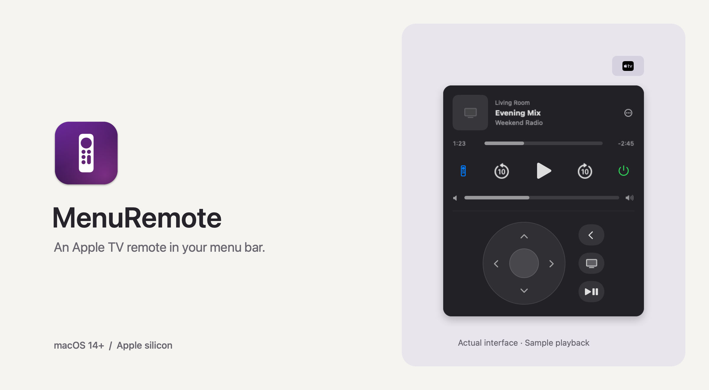

<p align="center">
  
  
  <a href="https://github.com/nickkjolsing/menuremote/actions/workflows/build.yml"></a>
</p>

# MenuRemote

A native macOS menu bar remote for Apple TV. See what's playing, control playback, and navigate your TV without reaching for another device.

- Artwork, playback progress, seeking, and 10-second skips.
- Direction pad, keyboard controls, volume, and sleep/wake.
- Automatic reconnect, device switching, and optional launch at login.

## Install

**Requires:** Apple silicon, macOS 14+, and [uv](https://docs.astral.sh/uv/getting-started/installation/). Keep your Mac and Apple TV on the same local network.

Install uv (`brew install uv` with [Homebrew](https://brew.sh/)), then download the ZIP from [Releases](https://github.com/nickkjolsing/menuremote/releases/latest), unzip it, and move **MenuRemote.app** to `/Applications`. Downloads appear after the first release is published.

Builds are ad-hoc signed, not notarized. macOS may block downloaded copies; see [Apple's instructions for opening an app from an unidentified developer](https://support.apple.com/en-us/102445).

<details>
<summary>Build from source</summary>

Requires [Xcode Command Line Tools](https://developer.apple.com/xcode/resources/) in addition to uv.

```sh
xcode-select --install # Skip if already installed; finish before continuing.
git clone https://github.com/nickkjolsing/menuremote.git
cd menuremote
./build.sh --install
```

`--install` copies the app to `/Applications` and opens it. Without that flag, the app lands in `build/MenuRemote.app`.

</details>

On first launch, MenuRemote uses uv to download Python 3.13 and install pyatv 0.18.0 in its own environment. Internet access is needed for this setup.

## Pair & play

1. Click the Apple TV icon in your menu bar and select your TV.
2. Enter the four-digit code shown on the TV. A second code may be requested.
3. Click the remote icon to expand the direction pad. Use **⋯** to switch TVs or enable **Launch at Login**.

Keyboard controls work while the panel is open and focused:

| Key | Action |
| --- | --- |
| Arrow keys / Return | Navigate / select |
| Space | Play / pause |
| Delete / `h` | Back / TV home |
| `[` / `]` | Skip back / forward 10 seconds |
| Escape | Close panel |

Volume, artwork, and seeking depend on the TV app and audio output. See [pyatv's supported features](https://pyatv.dev/documentation/supported_features/).

## Troubleshooting

- **No TV found?** Check the local network connection and allow MenuRemote under **System Settings → Privacy & Security → Local Network**, if listed. Try scanning again.
- **Setup failed?** Confirm uv is installed, then click **Retry**.
- **Connection lost?** Use **⋯ → Reconnect**. Logs: `~/Library/Logs/MenuRemote.log`.

Pairing credentials and the Python environment stay in `~/Library/Application Support/MenuRemote/`. Keep `pyatv.conf` private; redact device names and addresses before sharing logs.

## Contributing

Small PRs welcome. Run `./build.sh` before submitting. For bugs, [open an issue](https://github.com/nickkjolsing/menuremote/issues) with your macOS/tvOS versions, steps to reproduce, and relevant redacted logs.

Use Conventional Commit PR titles: `fix:` for patches, `feat:` for features, `feat!:` for breaking changes. See [Releasing](docs/RELEASING.md) for the automated release process.

[MIT licensed](LICENSE). Built with SwiftUI and [pyatv](https://github.com/postlund/pyatv). Not affiliated with Apple.
