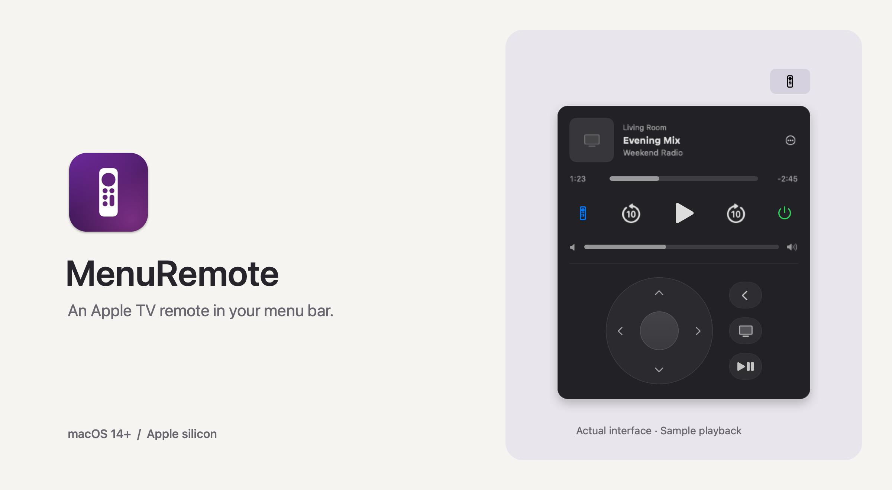

<p align="center">
  
  
  <a href="https://github.com/nickkjolsing/menuremote/actions/workflows/build.yml"></a>
</p>

# MenuRemote

A native macOS menu bar remote for Apple TV. See what's playing and control playback.

- Artwork, playback progress, seeking, and 10-second skips
- Direction pad, keyboard controls, volume, and sleep/wake
- Send text from your Mac to the active text field on Apple TV
- Automatic reconnect, device switching, and optional launch at login
- Manual in-app updates from GitHub Releases

## Install

**Requires:** Apple silicon and macOS 14+. Keep your Mac and Apple TV on the same local network. Python and the Apple TV helper are included; Homebrew and uv are not required.

Download the ZIP from [Releases](https://github.com/nickkjolsing/menuremote/releases/latest), unzip it, and move **MenuRemote.app** to `/Applications`.

Builds are ad-hoc signed, not notarized. macOS may block downloaded copies.

<details>
<summary>Build from source</summary>

Building requires [Xcode Command Line Tools](https://developer.apple.com/xcode/resources/) and [uv](https://docs.astral.sh/uv/getting-started/installation/). The build downloads a pinned Python and hash-locked dependencies, then packages the helper with PyInstaller. These tools are only needed on the build machine.

```sh
xcode-select --install # Skip if already installed; finish before continuing.
git clone https://github.com/nickkjolsing/menuremote.git
cd menuremote
./build.sh --install
```

`--install` copies the app to `/Applications` and opens it. Without that flag, the app lands in `build/MenuRemote.app`.

</details>

On launch, MenuRemote starts its bundled Python 3.13 / pyatv 0.18.0 helper. There are no first-launch dependency downloads. Allow local network access if macOS asks, then select and pair your TV.

The first TV search makes up to three attempts after temporary failures or empty results, giving local network access time to become available. If no TV appears, check the network and permission settings, then click the scan button to try again.

## Pair & play

1. Click the remote icon in your menu bar and select your TV.
2. Enter the four-digit code shown on the TV. A second code may be requested.
3. Click the remote icon to expand the direction pad. Use **⋯** to switch TVs or enable **Launch at Login**.

Click the center button to select, or press and hold it to open the focused item's context menu in apps that support one.

Use **⋯ → Check for Updates…** to look for a newer release and choose whether to install it. Updates preserve your pairing credentials. Automatic checks and installation are disabled.

Open **⋯ → About MenuRemote** for the app version, release notes, update checks, and Bitcoin receiving address. Click the address to copy it.

The text composer appears automatically when a search or other compatible text field is active on Apple TV, and disappears when you leave it. If MenuRemote's panel is closed, a quiet **Apple TV Keyboard** notification lets you click to open it and type. macOS asks for notification permission the first time; you can change it in System Settings. Notifications don't make sounds or open the panel automatically.

Type or paste on your Mac, then press **Return** or the send arrow. Text is appended to the TV's existing text; it doesn't submit the TV's form. Use the eye button to hide what you're typing. Text entry requires a compatible TV field and the Companion connection. Drafts stay in memory and clear when you switch TVs; MenuRemote doesn't fetch the TV's field contents.

MenuRemote remembers your TV's name between launches and refreshes it when reconnecting.

Keyboard controls work while the panel is open and focused:

| Key | Action |
| --- | --- |
| Arrow keys / Return | Navigate / select |
| Space | Play / pause |
| Delete / `h` | Back / TV home |
| `[` / `]` | Skip back / forward 10 seconds |
| Escape | Close panel |

Volume, artwork, and seeking depend on the TV app and audio output.

## Troubleshooting

- **No TV found?** Check the local network connection and allow MenuRemote under **System Settings → Privacy & Security → Local Network**, if listed. Try scanning again.
- **TV missing from the list?** Wake your Apple TV and scan again. The picker shows identified Apple TV hardware and filters out other receivers. New Apple TV model identifiers remain discoverable. Hardware generations, reported software versions, and IP addresses appear below each TV's name; hover for details and the software build.
- **Helper missing or damaged?** Download and unzip a fresh copy of MenuRemote, then replace the app in `/Applications`. Pairing credentials are stored separately.
- **Connection lost?** Use **⋯ → Reconnect**. Logs: `~/Library/Logs/MenuRemote.log`. Button presses include the key, tap/hold action, protocol, and whether sending completed.

Pairing credentials stay in `~/Library/Application Support/MenuRemote/`. Keep `pyatv.conf` private. Updates preserve this file. Older versions' `venv` folders are no longer used; the bundled helper updates with the app.

## Contributing

Small PRs welcome. Run `./build.sh` before submitting. For bugs, [open an issue](https://github.com/nickkjolsing/menuremote/issues) with your macOS/tvOS versions, steps to reproduce, and relevant redacted logs.

Use Conventional Commit PR titles: `fix:` for patches, `feat:` for features, `feat!:` for breaking changes. See [Releasing](docs/RELEASING.md) for the automated release process.

[MIT licensed](LICENSE). Built with SwiftUI and [pyatv](https://github.com/postlund/pyatv). Not affiliated with Apple.
